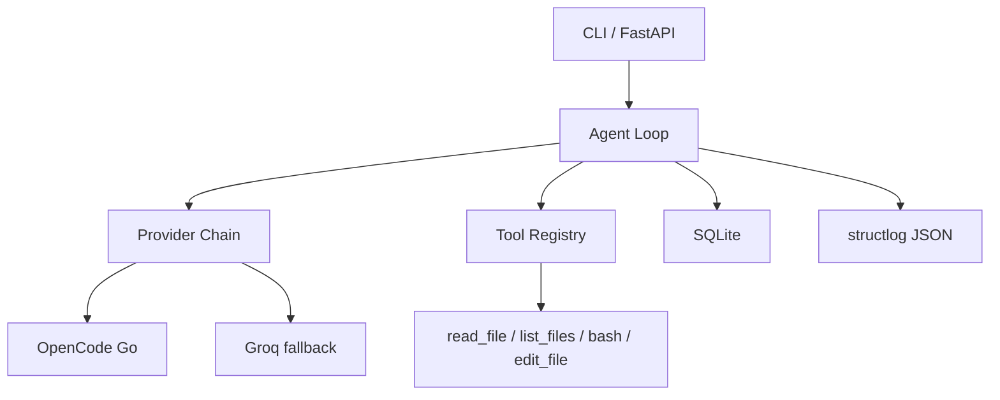

# pyagent

Minimal Python AI agent: tool calling, provider failover, SQLite state, structured logging. Portfolio project for a Junior AI Engineer role.

**Live demo:** https://pyagent.zachara.dev · [health](https://pyagent.zachara.dev/health) · [docs](https://pyagent.zachara.dev/docs)

## Architecture



## Try it in 60 seconds (no API key)

```bash
git clone https://github.com/benzac708/pyagent && cd pyagent
cp .env.example .env && sed -i 's/^MOCK_LLM=false/MOCK_LLM=true/' .env
uv venv && uv sync --all-extras
uv run python -m agent "hello, what can you do?"
uv run pytest -v          # 35 tests, all green
```

With `MOCK_LLM=true` the agent returns canned responses so you can explore the CLI, tool registry, SQLite state, and FastAPI endpoints without any API key.

## Quick start (real LLM)

```bash
git clone https://github.com/benzac708/pyagent && cd pyagent
uv venv && uv sync --all-extras
cp .env.example .env      # add your API key (Groq free tier works)
uv run python -m agent "read fizzbuzz.js"
uv run python -m agent "read fizzbuzz.js" --verbose
uv run python -m agent "what did I ask?" --resume <conv_id>
uv run uvicorn api.server:app --port 8000 && curl http://localhost:8000/health
```

## Key design decisions

| Decision | Why |
|----------|-----|
| Python + OpenAI SDK | Best LLM SDK ecosystem; one client covers OpenAI, Azure, Ollama, Groq, OpenCode Go |
| Tool registry pattern | Tools are name + JSON Schema + function; adding a tool = one file + one entry |
| Tools return error strings | LLM can read "Error: file not found" and recover instead of crashing |
| Max 10 iterations | Prevents infinite loops and runaway cost |
| Provider failover | Free-tier APIs rate-limit; agent retries with Groq automatically |
| SQLite (not Postgres) | Zero setup, built-in, single-file backup; enough for one user |
| Raw SQL (not ORM) | 4 tables, simple queries; ORM earns its keep at 20+ tables |
| structlog (JSON) | Greppable, aggregator-friendly; `/health` for monitoring |
| FastAPI | Auto OpenAPI docs, health checks, async support |
| Docker + systemd + Caddy | Reproducible env, auto-restart, one-line HTTPS |
| ruff + uv + pre-commit | One linter, fast package manager, Python-native hooks |

## Tools

| Tool | Description |
|------|-------------|
| `read_file` | Read file contents (sensitive paths blocked) |
| `list_files` | List directory contents |
| `bash` | Run shell command (timeout, output capped, trusted-user-only) |
| `edit_file` | Write content to file (atomic temp+rename) |

## Deployment

Live at **https://pyagent.zachara.dev** (Oracle Cloud VPS, Docker + Caddy + systemd).

```bash
docker compose up -d                                    # local
sudo systemctl enable --now pyagent                      # VPS
sudo systemctl enable --now pyagent-digest.timer         # daily digest at 07:00
```

Runtime: non-root container user, secrets via `env_file` (not mounted), SQLite in `./data/`, structured JSON logs to journald.

## For reviewers

**Problem:** LLMs are stateless and tool-less. pyagent wraps an OpenAI-compatible LLM in a loop that calls tools, remembers conversations in SQLite, and fails over between providers.

**Verify in 60 seconds:**
```bash
git clone https://github.com/benzac708/pyagent && cd pyagent
cp .env.example .env && sed -i 's/^MOCK_LLM=false/MOCK_LLM=true/' .env
uv venv && uv sync --all-extras
uv run pytest -v          # 35 tests, all green
uv run ruff check .       # clean
uv run mypy agent/ tools/ api/   # strict, 0 errors
uv run python -m agent "read fizzbuzz.js"   # tool call demo
```

**Security (best effort, not a sandbox):** secrets never in git (gitleaks), never in Docker image (.dockerignore), not readable as files (denylist + redaction), redacted in logs. `bash` runs arbitrary shell — trusted-user-only. See `tests/test_security.py`.

## License

MIT