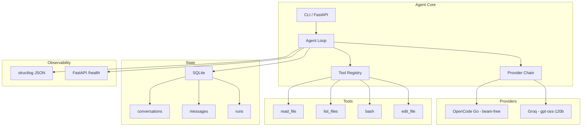

# pyagent

A minimal Python AI agent with tool calling, provider failover, SQLite state, and VPS deployment. Built as a portfolio project for a Junior AI Engineer position.

## Architecture



## Why each decision

### Python (not Go/Rust)
The job requires Python. Also, Python has the best LLM SDK ecosystem (openai, pydantic, fastapi).

### OpenAI SDK (not Anthropic SDK)
OpenAI-compatible API is the de facto standard. One client works with OpenAI, Azure, Ollama, Groq, and OpenCode Go. Switching providers is changing 3 env vars, not code.

### Tool registry pattern (not hardcoded tools)
Tools are defined as name + JSON Schema + function. The agent loop doesn't know what tools exist. Adding a tool means adding one file and one registry entry. No loop changes.

### Tools return error strings (not exceptions)
The LLM can read "Error: file not found" and try a different path. If you raise an exception, the agent crashes. The LLM is better at recovery than your error handling.

### Max iterations = 10
Most tasks need 2-4 tool calls. 10 gives headroom. If it hits 10, something is wrong (loop, bad input). Log it and stop. Prevents infinite loops and runaway costs.

### Provider failover (not single provider)
Free-tier APIs have rate limits. If OpenCode Go is down or rate-limited, the agent automatically retries with Groq. The agent loop doesn't know which provider it's talking to.

### SQLite (not Postgres/Redis)
Zero setup (it's a file). Built into Python. Handles single-user, low-write workloads. Back up with `cp`. Postgres would need a server, auth, backups — overkill for one user on one VPS.

### Raw SQL (not ORM)
4 tables, simple queries. SQLAlchemy would add 200 lines of config for 50 lines of queries. An ORM earns its keep at 20+ tables with complex joins.

### structlog (not print/logging)
JSON output is parseable by any log aggregator. When this runs on a VPS at 7am, you're not watching the terminal. `{"event": "run_finished", "status": "completed", "tokens": 450}` is greppable.

### FastAPI (not Flask)
Auto-generated OpenAPI docs (`/docs`). Built-in health checks. Async support. One dependency gives you a lot.

### Docker (not manual VPS setup)
Reproducible environment. If it works in the container, it works on the VPS. No "works on my machine" issues.

### systemd timer (not cron)
Integrates with journalctl for logs. `Persistent=true` runs missed jobs after reboot. cron is simpler but has none of these.

### Caddy (not nginx)
Automatic HTTPS with zero config. `caddy reverse-proxy --from agent.yourdomain.com --to localhost:8000`. One line. nginx's config complexity isn't worth it for a single service.

### ruff (not black + flake8 + isort)
One tool replaces three. One config. 100x faster (Rust). Less to maintain.

### uv (not pip/poetry)
10-100x faster than pip. Built-in virtualenv. Lock file for reproducibility. Drop-in pip replacement.

### pre-commit (not Husky)
Python-native. Tool-agnostic (runs ruff, mypy, pytest, or any command). Same config works in CI.

## Live demo

- **API:** https://pyagent.zachara.dev
- **Health:** https://pyagent.zachara.dev/health
- **Docs:** https://pyagent.zachara.dev/docs

## Try it in 60 seconds (no API key needed)

```bash
git clone https://github.com/benzac708/pyagent
cd pyagent
cp .env.example .env
# Enable mock mode (no API key required)
sed -i 's/^MOCK_LLM=false/MOCK_LLM=true/' .env
uv venv && uv sync --all-extras
uv run python -m agent "hello, what can you do?"
uv run pytest -v
```

With `MOCK_LLM=true` the agent returns canned responses so you can explore the
CLI, tool registry, SQLite state, and FastAPI endpoints without any API key.

## Quick start (real LLM)

```bash
git clone https://github.com/benzac708/pyagent
cd pyagent
uv venv && uv sync --all-extras
cp .env.example .env
# Edit .env with your API key (Groq free tier works: https://console.groq.com)

# Run
uv run python -m agent "read fizzbuzz.js"
uv run python -m agent "read fizzbuzz.js" --verbose

# Resume a conversation
uv run python -m agent "what did I ask?" --resume <conv_id>

# Health check
uv run uvicorn api.server:app --port 8000
curl http://localhost:8000/health

# Tests
uv run pytest -v
```

## Tools

| Tool | Description |
|------|-------------|
| `read_file` | Read file contents |
| `list_files` | List directory contents |
| `bash` | Run shell command (with timeout) |
| `edit_file` | Write content to file (atomic) |

## Providers

| Provider | Model | Cost | Role |
|----------|-------|------|------|
| OpenCode Go | beam-free | Free | Primary |
| Groq | gpt-oss-120b | Free | Fallback |

Switch providers by changing `.env` variables. No code changes needed.

## Deployment (production)

Live at **https://pyagent.zachara.dev** (VPS: Oracle Cloud, Docker + Caddy + systemd).

```bash
# Docker
docker build -t pyagent .
docker compose up -d
curl http://localhost:8000/health

# VPS (systemd)
sudo cp deploy/pyagent.service /etc/systemd/system/
sudo cp deploy/pyagent-digest.service /etc/systemd/system/
sudo cp deploy/pyagent-digest.timer /etc/systemd/system/
sudo systemctl daemon-reload
sudo systemctl enable --now pyagent
sudo systemctl enable --now pyagent-digest.timer   # daily digest at 07:00

# HTTPS (Caddy) — DNS-01 via Cloudflare
# Add a site block for your domain, then:
docker exec -e CADDY_ADMIN=127.0.0.1:9801 caddy caddy reload --config /etc/caddy/Caddyfile
```

**Runtime details:**
- Container runs as non-root user `agent` (uid 1000)
- Secrets injected via `env_file` (not mounted as a file) — `.env` is absent from the container
- SQLite DB persisted in `./data/` volume
- Daily digest timer: 07:00 local, `Persistent=true` (catches up after reboot)
- Logs: structured JSON via structlog → journald; no secrets logged

## Monitoring & backup

**Monitoring (optional):** a cron or healthchecks.io ping hitting `https://pyagent.zachara.dev/health`
every 5 minutes. Alert on non-200 or `"status":"error"`.

**Backup (optional):** `cp /opt/pyagent/data/agent.db /backup/agent-$(date +%F).db`
via a daily cron. SQLite is a single file — `cp` is a consistent snapshot when
the app is idle (or use `.backup` command for hot copies).

Both are intentionally not wired into the core app; they're ops concerns.

## Project structure

```
pyagent/
├── agent/
│   ├── config.py       # env loading, structlog setup
│   ├── db.py           # SQLite state
│   ├── loop.py         # agent loop
│   └── providers.py    # provider failover
├── tools/
│   ├── registry.py     # tool registry
│   ├── read_file.py
│   ├── list_files.py
│   ├── bash.py
│   └── edit_file.py
├── api/
│   └── server.py       # FastAPI /health
├── deploy/
│   ├── pyagent.service
│   ├── pyagent-digest.service
│   ├── pyagent-digest.timer
│   └── Caddyfile
├── tests/
│   ├── test_tools.py
│   ├── test_config.py
│   ├── test_db.py
│   ├── test_providers.py
│   ├── test_loop.py
│   ├── test_api.py
│   ├── test_integration.py
│   ├── test_security.py
│   └── helpers.py
├── Dockerfile
├── docker-compose.yml
├── pyproject.toml
├── .env.example
└── CHECKLIST.md
```

## For reviewers / recruiters

**What problem does this solve?** LLMs are stateless and tool-less. pyagent wraps an
OpenAI-compatible LLM in a loop that can call tools (read files, run bash, edit files),
remembers conversations in SQLite, and fails over between providers — all observable
via structured JSON logs and a `/health` endpoint.

**What to look at (5 min):**
1. `agent/loop.py` — the core agent loop (tool calls, max-iteration guard, persistence)
2. `agent/providers.py` — provider failover chain
3. `tools/registry.py` + any tool file — how tools are registered
4. `tests/` — 35 tests covering tools, db, providers, loop, API, security
5. Run `MOCK_LLM=true uv run python -m agent "hello"` — works with no API key

**Verify claims in 60 seconds:**
```bash
git clone https://github.com/benzac708/pyagent && cd pyagent
cp .env.example .env && sed -i 's/^MOCK_LLM=false/MOCK_LLM=true/' .env
uv venv && uv sync --all-extras
uv run pytest -v          # 35 tests, all green
uv run ruff check .       # clean
uv run python -m agent "read fizzbuzz.js"   # tool call demo
curl http://localhost:8000/health  # after: uv run uvicorn api.server:app --port 8000
```

**Security posture:** secrets are never in git (gitleaks), never in the Docker image
(.dockerignore), never readable by agent tools (denylist + redaction), and never in
logs (structlog redaction). See `tests/test_security.py`.

## License

MIT

