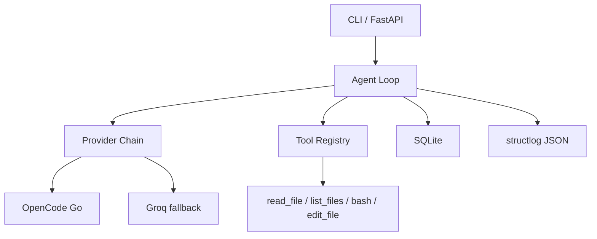

# pyagent

Minimal Python AI agent: tool calling, provider failover, SQLite state, structured logging. Portfolio project for a Junior AI Engineer role.

**Live demo:** https://pyagent.zachara.dev · [health](https://pyagent.zachara.dev/health) · [docs](https://pyagent.zachara.dev/docs)

## Try it in 60 seconds

```bash
git clone https://github.com/benzac708/pyagent && cd pyagent
cp .env.example .env && sed -i 's/^MOCK_LLM=false/MOCK_LLM=true/' .env
uv venv && uv sync --all-extras
uv run pre-commit install                            # one-time, enables git hooks
uv run python -m agent "hello, what can you do?"          # mock mode, no API key
uv run python -m agent "read fizzbuzz.js"                 # tool call demo
uv run pytest -v && uv run ruff check . && uv run mypy agent/ tools/ api/
```

With `MOCK_LLM=true` the agent returns canned responses so you can explore the CLI, tool registry, SQLite state, and FastAPI endpoints without any API key. For a real LLM, set `API_KEY` in `.env` (Groq free tier works).

## Architecture



## Key design decisions

| Decision | Why |
|----------|-----|
| OpenAI SDK (not Anthropic) | One client covers OpenAI, Azure, Ollama, Groq, OpenCode Go |
| Tool registry pattern | Adding a tool = one file + one registry entry, no loop changes |
| Tools return error strings | LLM reads "Error: file not found" and recovers instead of crashing |
| Max 10 iterations | Prevents infinite loops and runaway cost |
| Provider failover | Free-tier APIs rate-limit; agent retries with Groq automatically |
| SQLite (not Postgres) | Zero setup, single-file backup, enough for one user |
| Raw SQL (not ORM) | 4 tables, simple queries |
| structlog (JSON) | Greppable, aggregator-friendly; `/health` for monitoring |

## Deployment

Live at **https://pyagent.zachara.dev** (Oracle Cloud VPS, Docker + Caddy + systemd).

```bash
docker compose up -d                                    # local
sudo systemctl enable --now pyagent                      # VPS
sudo systemctl enable --now pyagent-digest.timer         # daily digest at 07:00
```

Runtime: non-root container user, secrets via `env_file`, SQLite in `./data/`, JSON logs to journald.

## Security

Secrets: gitignored + gitleaks, not in Docker image (.dockerignore), unreadable via tools (denylist + redaction), redacted in logs. `bash` runs arbitrary shell - trusted-user-only. See `tests/test_security.py`.

## License

MIT