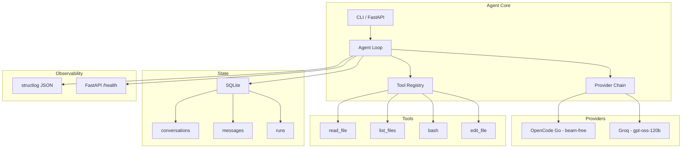

# pyagent

A minimal Python AI agent with tool calling, provider failover, SQLite state, and VPS deployment. Built as a portfolio project for a Junior AI Engineer position.

## Architecture



## Why each decision

### Python (not Go/Rust)
The job requires Python. Also, Python has the best LLM SDK ecosystem (openai, pydantic, fastapi).

### OpenAI SDK (not Anthropic SDK)
OpenAI-compatible API is the de facto standard. One client works with OpenAI, Azure, Ollama, Groq, and OpenCode Go. Switching providers is changing 3 env vars, not code.

### Tool registry pattern (not hardcoded tools)
Tools are defined as name + JSON Schema + function. The agent loop doesn't know what tools exist. Adding a tool means adding one file and one registry entry. No loop changes.

### Tools return error strings (not exceptions)
The LLM can read "Error: file not found" and try a different path. If you raise an exception, the agent crashes. The LLM is better at recovery than your error handling.

### Max iterations = 10
Most tasks need 2-4 tool calls. 10 gives headroom. If it hits 10, something is wrong (loop, bad input). Log it and stop. Prevents infinite loops and runaway costs.

### Provider failover (not single provider)
Free-tier APIs have rate limits. If OpenCode Go is down or rate-limited, the agent automatically retries with Groq. The agent loop doesn't know which provider it's talking to.

### SQLite (not Postgres/Redis)
Zero setup (it's a file). Built into Python. Handles single-user, low-write workloads. Back up with `cp`. Postgres would need a server, auth, backups — overkill for one user on one VPS.

### Raw SQL (not ORM)
4 tables, simple queries. SQLAlchemy would add 200 lines of config for 50 lines of queries. An ORM earns its keep at 20+ tables with complex joins.

### structlog (not print/logging)
JSON output is parseable by any log aggregator. When this runs on a VPS at 7am, you're not watching the terminal. `{"event": "run_finished", "status": "completed", "tokens": 450}` is greppable.

### FastAPI (not Flask)
Auto-generated OpenAPI docs (`/docs`). Built-in health checks. Async support. One dependency gives you a lot.

### Docker (not manual VPS setup)
Reproducible environment. If it works in the container, it works on the VPS. No "works on my machine" issues.

### systemd timer (not cron)
Integrates with journalctl for logs. `Persistent=true` runs missed jobs after reboot. cron is simpler but has none of these.

### Caddy (not nginx)
Automatic HTTPS with zero config. `caddy reverse-proxy --from agent.yourdomain.com --to localhost:8000`. One line. nginx's config complexity isn't worth it for a single service.

### ruff (not black + flake8 + isort)
One tool replaces three. One config. 100x faster (Rust). Less to maintain.

### uv (not pip/poetry)
10-100x faster than pip. Built-in virtualenv. Lock file for reproducibility. Drop-in pip replacement.

### pre-commit (not Husky)
Python-native. Tool-agnostic (runs ruff, mypy, pytest, or any command). Same config works in CI.

## Quick start

```bash
# Clone and setup
git clone https://github.com/yourusername/pyagent
cd pyagent
uv venv && uv sync --all-extras
cp .env.example .env
# Edit .env with your API key

# Run
uv run python -m agent "read fizzbuzz.js"
uv run python -m agent "read fizzbuzz.js" --verbose

# Resume a conversation
uv run python -m agent "what did I ask?" --resume <conv_id>

# Health check
uv run uvicorn api.server:app --port 8000
curl http://localhost:8000/health

# Tests
uv run pytest -v
```

## Tools

| Tool | Description |
|------|-------------|
| `read_file` | Read file contents |
| `list_files` | List directory contents |
| `bash` | Run shell command (with timeout) |
| `edit_file` | Write content to file (atomic) |

## Providers

| Provider | Model | Cost | Role |
|----------|-------|------|------|
| OpenCode Go | beam-free | Free | Primary |
| Groq | gpt-oss-120b | Free | Fallback |

Switch providers by changing `.env` variables. No code changes needed.

## Deployment

```bash
# Docker
docker build -t pyagent .
docker compose up -d

# VPS (systemd)
sudo cp deploy/pyagent.service /etc/systemd/system/
sudo systemctl enable --now pyagent

# HTTPS (Caddy)
# Edit deploy/Caddyfile with your domain, then:
caddy run --config deploy/Caddyfile
```

## Project structure

```
pyagent/
├── agent/
│   ├── config.py       # env loading, structlog setup
│   ├── db.py           # SQLite state
│   ├── loop.py         # agent loop
│   └── providers.py    # provider failover
├── tools/
│   ├── registry.py     # tool registry
│   ├── read_file.py
│   ├── list_files.py
│   ├── bash.py
│   └── edit_file.py
├── api/
│   └── server.py       # FastAPI /health
├── deploy/
│   ├── pyagent.service
│   ├── pyagent-digest.service
│   ├── pyagent-digest.timer
│   └── Caddyfile
├── tests/
│   ├── test_tools.py
│   └── test_config.py
├── Dockerfile
├── docker-compose.yml
├── pyproject.toml
├── .env.example
└── CHECKLIST.md
```

## License

MIT

